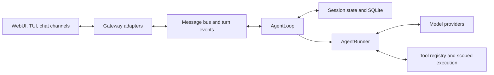

# TypeScript runtime design

This proposal moves the nanobot gateway runtime to TypeScript in the existing repository. The new package will live in `packages/runtime-ts/`. Python stays the default during development and the opt-in pilot. WebUI and TUI continue to use the HTTP and WebSocket contracts of the same nanobot release. The first pilot supports persistent chat, streaming, cancellation, recovery, and scoped tools with an OpenAI-compatible model. The default switch depends on the broader compatibility and release checks in the [migration plan](./typescript-runtime-migration-plan.md).

## Runtime and package boundary

Use Node.js 24 LTS as the initial server runtime candidate. Prototype shipping a managed executable and any required native dependencies in the platform wheel before selecting the runtime. Verify that a clean installation starts and stops the packaged gateway from a private home with Node, Bun, and Git absent from `PATH`. Use the same installed-package check for the release matrix. [Native acceptance workflow](../.github/workflows/native-acceptance.yml) · [Release packaging contract](./releasing.md#non-publishing-preview-preflight)

A local prototype can use `node:sqlite` to verify the database format. Driver selection remains open until the prototype demonstrates interruptible reads and a responsive gateway under database contention. Keep blocking database operations off the gateway event loop. Confirm runtime selection with SQLite compatibility, read cancellation, and child-process cleanup. Prefer the existing TypeScript build and test conventions where they fit the server package. [Python SQLite implementation](../nanobot/session/sqlite_store.py) · [TUI development conventions](../tui/README.md)

| Owner | Responsibility and existing reference |
| --- | --- |
| Gateway composition | Start and stop the runtime, own MCP connections and enabled channels, manage background jobs and readiness, and drain admitted work on shutdown. [Python composition root](../nanobot/cli/gateway_runtime.py) · [Gateway process lifecycle](../nanobot/gateway/runtime.py) |
| Message bus and admission | Distinguish awaited in-process subscribers from queued channel delivery. Carry typed events and scoped turn identifiers. [Bus](../nanobot/bus/queue.py) · [Runtime admission](../nanobot/runtime_admission.py) |
| Agent loop and runner | The loop owns session and workspace selection, context assembly, scheduling, cancellation and turn delivery. The runner owns model requests, tool invocations, and iteration and context limits. [AgentLoop](../nanobot/agent/loop.py) · [ContextBuilder](../nanobot/agent/context.py) · [AgentRunner](../nanobot/agent/runner.py) |
| Session state and storage | Own ordered writes, read snapshots, checkpoints, pending inputs, generations and history revisions. Keep model replay and display history as separate projections. [Session state](../nanobot/session/state.py) · [SQLite storage](../nanobot/session/sqlite_store.py) |
| Workspace policy and execution | Resolve permissions at the point of execution. File operations, outbound HTTP and subprocesses use the same policy and execution primitives across built-in tools and adapters. [Security boundaries](../.agent/security.md) |
| Client-facing adapters | Own HTTP, WebSocket and channel representations, authorization, routing, and transcript delivery. Keep gateway-specific transport and display logic outside the execution loop. [WebUI coordination](../nanobot/session/webui_turns.py) · [Outbound delivery](../nanobot/webui/outbound_delivery.py) |

Keep execution and state independent of client rendering and transport implementations. Reuse the shared TypeScript client event fixtures where they cover the existing wire contract. Decode and validate external inputs at the boundaries, including configuration, stored records, provider responses, and tool arguments. [Architecture constraints](../.agent/design.md) · [Shared fixtures](../packages/client-events/fixtures.json)

## Compatibility and failure behavior

### Configuration and storage

Preserve supported config aliases, defaults, environment interpolation, atomic saves and file permissions. Use the existing instance and workspace identity rules to locate config, sessions and related data. Treat SQLite schema v6 as the initial compatibility target. Preserve WAL, foreign keys, consistent read snapshots, transaction boundaries, and one-time legacy JSONL import for the current release line. Exercise existing databases and legacy inputs in addition to newly created databases. [Config loader](../nanobot/config/loader.py) · [Schema and transactions](../nanobot/session/sqlite_store.py) · [Session locations](../nanobot/session/location.py)

Preserve the distinction between a committed answer, an interrupted model request, and a tool whose outcome is uncertain. A committed answer can be recovered without a model request. An uncertain tool outcome follows the existing recovery policy before any follow-up proceeds. Ordered mutations and generation checks prevent a late result from modifying a session that has been reset, deleted or replaced. The shutdown path stops new admission, settles accepted persistence operations, and then closes owned resources. [Recovery implementation](../nanobot/session/recovery.py) · [Storage regression tests](../tests/session/test_sqlite_storage.py)

### Context, streaming and cancellation

Preserve the actual model request produced from a turn. Resolve the agent workspace and the effective project workspace independently, load the applicable bootstrap instructions and project `AGENTS.md`, and apply the same memory and skill inclusion rules. Build replay from the session's model history and summary, including after restart. Compare captured provider inputs across runtimes using a fixture with an existing history, project instructions, `MEMORY.md`, and an enabled always-on skill. Exercise temporary chat to verify its memory exclusion. [Context assembly](../nanobot/agent/context.py) · [Workspace scope tests](../tests/agent/test_workspace_scope.py) · [History replay tests](../tests/agent/test_history_replay.py)

Propagate request cancellation into model streams, tools and supported reads. Test response ordering, idle timeout, stream closure, terminal frames, partial output, and retries across the provider and gateway boundaries. Settlement of accepted writes follows the session contract even when the caller stops waiting. Use deterministic model and tool fixtures for cross-runtime comparisons and run each engine with its own temporary workspace when comparing side effects. [Provider streaming tests](../tests/providers/test_internal_streaming.py) · [Session recovery tests](../tests/session/test_recovery.py)

### Tool permissions

Migrate scoped file operations, outbound HTTP validation, and host process control before enabling the corresponding tools in a pilot. Preserve the effective workspace and capability-specific access rules, network checks across redirects and MCP HTTP requests, and configured sandbox behavior on each OS. Verify cancellation and shutdown against real process trees on supported platforms. Keep the platform behavior documented by the existing runtime so a language change does not widen the permissions granted by a profile. [Security boundaries](../.agent/security.md) · [Process tests](../tests/tools/test_exec_platform.py)

### Client protocol and distribution

The pilot targets the full `webui.core.v1` contract for same-release WebUI clients. Inventory every required HTTP route, WebSocket action and event used by the shipped client. Start with authenticated `/webui/bootstrap`, `/api/sessions` and `/api/sessions/{key}/webui-thread`, then trace session and settings mutations, `new_chat` and `attach` actions, request receipts, replay, `turn_end`, and authenticated attachment and media paths. Advertise the core capability only after all required interfaces pass against the real gateway. Optional features deferred from the pilot need a named capability and a client gate for both the control and the request. For example, binary attachment upload has its own `webui.attachments.binary.v1` capability. [WebUI host contract](../.agent/review-guide.md) · [Capability declarations](../nanobot/webui/client_contract.py) · [WebSocket protocol](./websocket.md) · [WebUI HTTP client](../webui/src/lib/api.ts) · [WebUI socket client](../webui/src/lib/nanobot-client.ts)

Verify the TUI identity handshake independently. Exercise the installed WebUI and TUI against real gateways. Cover unauthorized requests, attachment upload and download scope, session mutations, and reconnect after restart with previously issued credentials and cached capability state. Verify that the local installation supplies executable browser assets when connecting to a remote host. [Gateway smoke tests](../tests/webui/test_gateway_webui_smoke.py) · [HTTP route tests](../nanobot/channels/websocket/tests/test_websocket_http_routes.py) · [Remote proxy tests](../tests/webui/test_remote_proxy.py)

Keep the Python SDK and its in-process hooks available. For the first default switch, keep instances that depend on Python `nanobot.tools` entry points on an explicit Python runtime selection. Check the selection before cutover and require it for plugin-dependent instances until a supported extension host passes discovery and invocation tests. Verify that CLI, service and updater launches honor that selection and that the Python SDK respects ownership when it writes profile data. [Python SDK](./python-sdk.md) · [Tool entry point loader](../nanobot/agent/tools/loader.py) · [Release checklist](./releasing.md)

## Pilot, cutover and rollback

Use a separate instance profile and a consistent copy of its data for the opt-in pilot. Resolve and verify the pilot's config, state, and workspace paths so writable roots are disjoint from the source instance. Keep schedules, local triggers and external delivery disabled on copied data unless the pilot explicitly uses isolated destinations. [Profile store inventory](../nanobot/data_access.py)

Enforce a single writer for migrated profiles across Python and TypeScript. Use a durable handoff reservation and an exclusive runtime claim that both engines honor for the same canonical store roots, including roots that overlap through aliases or parent and child paths. Verify both gateways, automatic and service launches, and write-capable CLI and SDK entry points against that ownership before they open writable stores. Existing shared runtime leases coordinate maintenance and provide the starting point for this design. Keep any entry point that cannot honor the claim on disjoint data roots. [Data leases](../nanobot/data_access.py) · [Profile ownership tests](../tests/test_update_profiles.py)

Use the following handoff in either direction. Preserve the reservation on interruption so an operator can inspect the recorded phase and resume or roll back the same handoff. [Protected restart and activation](../nanobot/update_restart.py)

1. Resolve the requested instance and the canonical store inventory. Verify the current runtime and identify processes that can write overlapping roots. Pause intake and scheduling, drain active work, and stop those writers. Claim the scoped reservation before proceeding. If another writer starts during the stop, pause the handoff until exclusive access is confirmed.
2. Under the reservation, take a consistent backup of SQLite and associated configuration, memory, attachments, and other profile stores. Start only the selected candidate with a scoped startup grant. The candidate acquires the exclusive runtime claim before opening writable stores and keeps task intake closed. Verify the instance, runtime identity, and ability to load the session state.
3. Activate the verified candidate under its exclusive claim. Check readiness and one complete turn. Release the temporary handoff reservation once the candidate holds the active claim. If startup fails, stop the candidate under the reservation and confirm the previous runtime can read any initialization changes, or restore the verified snapshot, before restarting it.

Direct rollback with TS-written data depends on both runtimes understanding every enabled persisted format and its recovery semantics. A one-way format change requires an export or reverse migration to preserve writes made after cutover. Restoring the cutover snapshot recovers the state at the time of that snapshot. [Update and recovery reference](./updating.md) · [Migration plan](./typescript-runtime-migration-plan.md)
