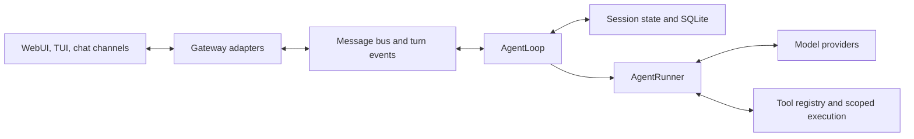

# TypeScript runtime design

This proposal moves the nanobot gateway runtime to TypeScript in the existing repository. The new package will live in `packages/runtime-ts/`. Python stays the default during development and the opt-in pilot. WebUI and TUI continue to use the HTTP and WebSocket contracts of the same nanobot release. The first pilot supports persistent chat, streaming, cancellation, recovery, and scoped tools with an OpenAI-compatible model. The default switch depends on the broader compatibility and release checks in the [migration plan](./typescript-runtime-migration-plan.md).

## Runtime and package boundary

Use Node.js 24 LTS as the initial server runtime candidate. Confirm the choice with packaged startup and shutdown on supported platforms, SQLite compatibility and read cancellation, and child-process cleanup. A local prototype can use `node:sqlite` to verify the database format. Driver selection remains open until the prototype demonstrates interruptible reads and a responsive gateway under database contention. Keep blocking database operations off the gateway event loop. Prefer the existing TypeScript build and test conventions where they fit the server package. [Python SQLite implementation](../nanobot/session/sqlite_store.py) · [TUI development conventions](../tui/README.md)

| Owner | Responsibility and existing reference |
| --- | --- |
| Gateway composition | Start and stop the runtime, own MCP connections and enabled channels, manage background jobs and readiness, and drain admitted work on shutdown. [Python composition root](../nanobot/cli/gateway_runtime.py) · [Gateway process lifecycle](../nanobot/gateway/runtime.py) |
| Message bus and admission | Distinguish awaited in-process subscribers from queued channel delivery. Carry typed events and scoped turn identifiers. [Bus](../nanobot/bus/queue.py) · [Runtime admission](../nanobot/runtime_admission.py) |
| Agent loop and runner | The loop owns session and workspace selection, scheduling, cancellation and turn delivery. The runner owns model requests, tool invocations, and iteration and context limits. [AgentLoop](../nanobot/agent/loop.py) · [AgentRunner](../nanobot/agent/runner.py) |
| Session state and storage | Own ordered writes, read snapshots, checkpoints, pending inputs, generations and history revisions. Keep model replay and display history as separate projections. [Session state](../nanobot/session/state.py) · [SQLite storage](../nanobot/session/sqlite_store.py) |
| Workspace policy and execution | Resolve permissions at the point of execution. File operations, outbound HTTP and subprocesses use the same policy and execution primitives across built-in tools and adapters. [Security boundaries](../.agent/security.md) |
| Client-facing adapters | Own HTTP, WebSocket and channel representations, authorization, routing, and transcript delivery. Keep gateway-specific transport and display logic outside the execution loop. [WebUI coordination](../nanobot/session/webui_turns.py) · [Outbound delivery](../nanobot/webui/outbound_delivery.py) |

Keep execution and state independent of client rendering and transport implementations. Reuse the shared TypeScript client event fixtures where they cover the existing wire contract. Decode and validate external inputs at the boundaries, including configuration, stored records, provider responses, and tool arguments. [Architecture constraints](../.agent/design.md) · [Shared fixtures](../packages/client-events/fixtures.json)

## Compatibility and failure behavior

### Configuration and storage

Preserve supported config aliases, defaults, environment interpolation, atomic saves and file permissions. Use the existing instance and workspace identity rules to locate config, sessions and related data. Treat SQLite schema v6 as the initial compatibility target. Preserve WAL, foreign keys, consistent read snapshots, transaction boundaries, and one-time legacy JSONL import for the current release line. Exercise existing databases and legacy inputs in addition to newly created databases. [Config loader](../nanobot/config/loader.py) · [Schema and transactions](../nanobot/session/sqlite_store.py) · [Session locations](../nanobot/session/location.py)

Preserve the distinction between a committed answer, an interrupted model request, and a tool whose outcome is uncertain. A committed answer can be recovered without a model request. An uncertain tool outcome follows the existing recovery policy before any follow-up proceeds. Ordered mutations and generation checks prevent a late result from modifying a session that has been reset, deleted or replaced. The shutdown path stops new admission, settles accepted persistence operations, and then closes owned resources. [Recovery implementation](../nanobot/session/recovery.py) · [Storage regression tests](../tests/session/test_sqlite_storage.py)

### Streaming and cancellation

Propagate request cancellation into model streams, tools and supported reads. Test response ordering, idle timeout, stream closure, terminal frames, partial output, and retries across the provider and gateway boundaries. Settlement of accepted writes follows the session contract even when the caller stops waiting. Use deterministic model and tool fixtures for cross-runtime comparisons and run each engine with its own temporary workspace when comparing side effects. [Provider streaming tests](../tests/providers/test_internal_streaming.py) · [Session recovery tests](../tests/session/test_recovery.py)

### Tool permissions

Migrate scoped file operations, outbound HTTP validation, and host process control before enabling the corresponding tools in a pilot. Preserve the effective workspace and capability-specific access rules, network checks across redirects and MCP HTTP requests, and configured sandbox behavior on each OS. Verify cancellation and shutdown against real process trees on supported platforms. Keep the platform behavior documented by the existing runtime so a language change does not widen the permissions granted by a profile. [Security boundaries](../.agent/security.md) · [Process tests](../tests/tools/test_exec_platform.py)

### Client protocol and distribution

Preserve bootstrap, authentication, session identity, attachment access, request receipts, replay and completion events for same-release WebUI and TUI clients. Validate the WebUI capability contract and terminal identity handshake independently. For remote hosts, the local installation continues to own executable browser assets. Optional features advertised in a pilot must be backed by the running gateway. Prove compatibility with real gateway processes and actual clients before enabling the pilot. [WebUI host contract](../.agent/review-guide.md) · [WebSocket protocol](./websocket.md) · [Gateway smoke tests](../tests/webui/test_gateway_webui_smoke.py)

Keep the Python SDK and plugin path available while their compatibility is evaluated. The Python SDK exposes in-process hooks and tool behavior, so a gateway client alone cannot satisfy its full API contract. Decide and verify how packaged installs, services, updates, and existing Python callers select a runtime before switching the default. [Python SDK](./python-sdk.md) · [Release checklist](./releasing.md)

## Pilot, cutover and rollback

Use a separate instance profile and a consistent copy of its data for the opt-in pilot. An instance has a single active runtime owner. Compare deterministic behavior in CI and use isolated real workloads for the pilot so schedules, tool actions and notifications run once per intended request.

For a production handoff, stop admitting new work, drain active turns and background jobs, close the old runtime, and take a consistent backup of SQLite and the associated configuration, memory and other profile data. Start the new runtime against the instance and verify readiness, session loading, and one complete turn. Exercise the same handoff in the opposite direction before offering direct rollback.

Direct rollback with TS-written data depends on both runtimes understanding every enabled persisted format and its recovery semantics. A one-way format change requires an export or reverse migration to preserve writes made after cutover. Restoring the cutover snapshot recovers the state at the time of that snapshot. [Update and recovery reference](./updating.md) · [Migration plan](./typescript-runtime-migration-plan.md)
